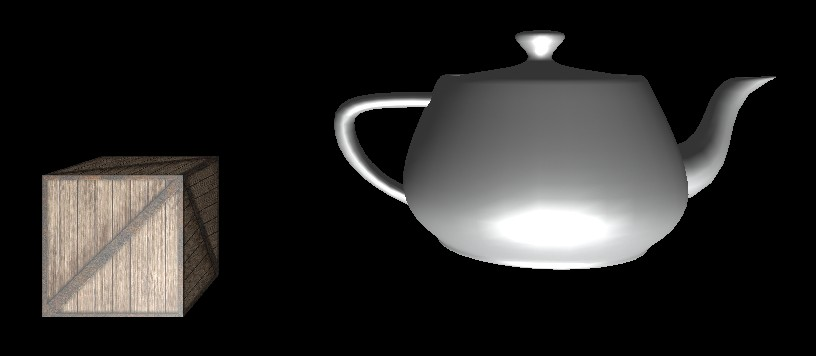

# 3dRenderer

A fully software-based 3D rendering pipeline implemented from scratch, without relying on any hardware acceleration APIs such as OpenGL or Direct3D.

This project demonstrates a low-level understanding of modern graphics pipelines by rebuilding them entirely on the CPU.

## Overview

This renderer implements a complete 3D graphics pipeline in software, including geometry processing, rasterization, and shading.

All stages of the rendering process are explicitly implemented without GPU support or external rendering libraries.

## Rendering Pipeline

The implemented pipeline follows a classic structure:

- Model loading
- World, view, and projection transformations
- Triangle rasterization
- Depth testing (Z-buffer)
- Fragment shading

## Features

- Load 3D meshes from external files
- Wireframe rendering mode
- Texture mapping
- Backface culling
- Z-buffer based hidden surface removal
- Ambient and diffuse lighting (Lambert model)
- Movable camera system

## Technical Highlights

- Fully CPU-based rasterizer (no GPU or graphics API)
- Manual triangle rasterization
- Per-fragment depth testing using a Z-buffer
- Software texture sampling
- Matrix and vector transformations for the full pipeline
- Explicit implementation of each rendering stage

## Demo

## TODO

- 2D clipping (screen space)
- 3D clipping (view frustum)
- Perspective-correct interpolation

## Motivation

The goal of this project is to understand how graphics pipelines work internally by implementing them from scratch.

It is intended for learning, experimentation, and demonstrating low-level graphics programming skills.

## Future Work

- Perspective-correct texture mapping
- Improved lighting models (Phong, Blinn-Phong)
- Shadow mapping (software)
- Performance optimization (SIMD, multi-threading)
